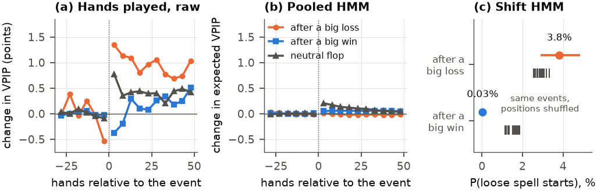
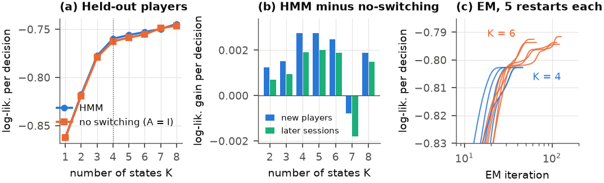
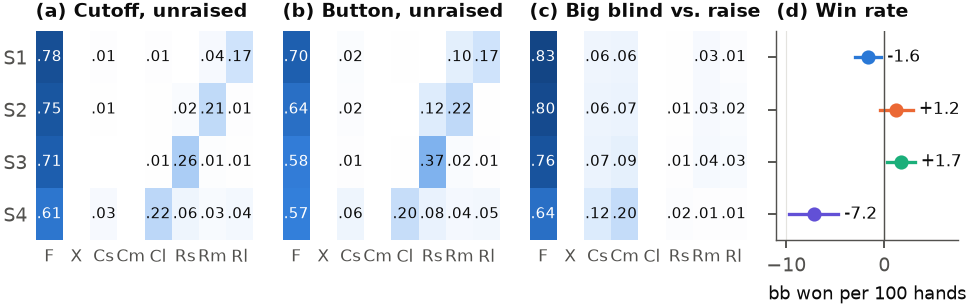
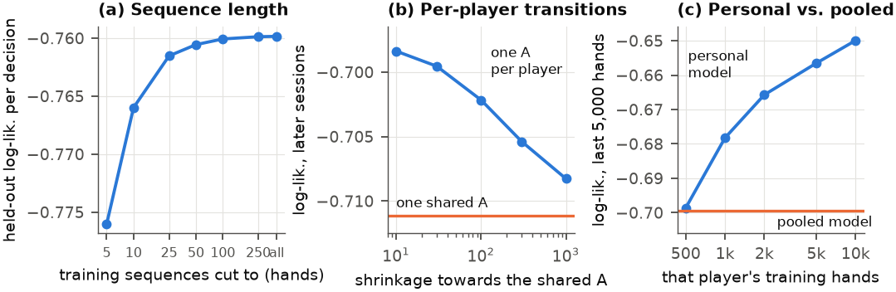

# Detecting Latent Playing Styles and Tilt in Poker with Hidden Markov Models

Final project for **CSE 150A/250A: Probabilistic Reasoning and Learning** (UC San Diego, Fall 2026),
group **Bob's Clan**: Ishaan Tibdewal, Ayush Urs, Abhishai Ganta, Pratham Chheda, Saksham Arora.

We ask two questions about online poker players, using only their public betting actions:

1. Can a hidden Markov model (HMM) recover a small set of interpretable **playing styles**?
2. Does one of the hidden states behave like **tilt**, a spell of looser play after a painful loss?

Everything (data pipeline, Baum–Welch, forward–backward, Viterbi, all variants and tests) is
implemented from scratch in NumPy and checked against brute-force enumeration and `hmmlearn`.

> **Status.** The analysis is complete. The report in [`report/`](report/) is a final draft: the
> per-member contribution statements and the generative-AI note in Section 6 are placeholders the
> team still has to write.

---

## Contents

1. [Results in brief](#results-in-brief)
2. [Data](#data)
3. [Models](#models)
4. [Experiments and findings](#experiments-and-findings)
5. [Repository layout](#repository-layout)
6. [Reproducing everything](#reproducing-everything)
7. [Correctness tests](#correctness-tests)
8. [Limitations](#limitations)
9. [Changes from the proposal](#changes-from-the-proposal)
10. [References](#references)

---

## Results in brief

| Question | Answer |
|---|---|
| Can an HMM recover playing styles? | **Yes.** A 4-state HMM finds four styles that match poker's own categories (tight, aggressive, loose-passive). Held-out players in the loose-passive state lose **7.2 big blinds per 100 hands** [95% CI −9.7, −4.7], a quantity the model never sees. |
| Are those states moods that change during a session? | **No, they are traits.** 88% of sessions never change state, and a model with no switching at all gets 97% of the HMM's gain over a model with no hidden state. |
| Is tilt in the data? | **Yes, but it is small.** In the 30 hands after a big loss, players enter **1.04 percentage points** more pots than after a big win [0.78, 1.31]. |
| Can the pooled HMM see it? | **No.** Its posteriors do not move after losses, and letting its transitions depend on a recent loss (an input-output HMM) does no better than shuffled inputs. |
| Can any HMM see it? | **Partly.** A "shift HMM", in which each player is their own baseline, finds rare spells of looser play lasting about 300 hands. One starts after **3.8%** of big losses [2.9, 4.8] but after only 0.03% of big wins. This explains at most about a quarter of the average effect. |



*(a) Share of hands played around big losses, big wins and neutral flops (held-out data).
(b) The pooled HMM's posterior-expected VPIP stays flat. (c) Shift HMM: chance that a loose
spell starts right after an event, against 20 fits with the event positions shuffled.*

---

## Data

**Source.** The poker hand history dataset of Kim (2024, 2025), in the PHH format, mirrored on
Hugging Face as [`takara-ai/poker_hands`](https://huggingface.co/datasets/takara-ai/poker_hands)
(CC BY 4.0, 37 parquet shards, 1.3 GB). Its main part is a scrape of 21.6M no-limit hold'em hands
from six online sites, 1–23 July 2009, with anonymised but consistent player IDs, stacks, every
action with its bet size, table and start time. It also contains the 10,000 hands of the Pluribus
poker bot (Brown and Sandholm, 2019), which we use as a negative control.

The data is **not** in this repository; see [Reproducing everything](#reproducing-everything).

**Why PartyPoker only.** Defining a "big loss" requires each player's net result per hand, and only
PartyPoker records winnings for every hand
([`code/survey_sites.py`](code/survey_sites.py)):

| Site | Hands with no winnings recorded |
|---|---|
| PartyPoker | 0% |
| Ongame | 1% |
| Absolute Poker | 18% |
| PokerStars, Full Tilt | 73% |
| iPoker | 100% |

**Filtering.** We keep PartyPoker tables with at least 200 hands at which no more than six players
were ever dealt in (6-max), at four stakes (big blind $0.25, $4, $6, $10). This leaves
**2,641,392 hands, 331 tables, 29,944 players**. All amounts are in big blinds (bb).

**Net result.** We replay the betting of each hand to get the chips each player put in; net result
is winnings minus chips put in. As a check, the next starting stack at the same table equals stack
plus net result (within 0.02 bb) for 90.8% of 13.3M consecutive-hand pairs. The rest are top-ups
(6.9%) and hands missing from the scrape (2.4%).

**Sequences.** One sequence is **one session of one player**: all their hands at all tables, in
order of start time, cut at gaps of more than 30 minutes. We use this rather than per-table
sequences because the median session spans 4 tables at once. We keep sessions of at least 100
hands and players with at least 500 such hands: **2,618 players, 23,379 sessions, 9.70M
player-hands** (median session 243 hands).

**Observations per hand.** Each hand contributes the player's first pre-flop decision as two
observed variables:

- **Action** `x_t`, 8 symbols: fold, check, call (small/medium/large price), raise
  (small/medium/large relative to the pot). Size cut points are the training-set terciles. A
  3-symbol version (fold, check/call, raise) is used as an ablation.
- **Context** `c_t`, 10 values: position group (early, cutoff, button, small blind, big blind) ×
  whether someone has already raised. Position rotates every hand and strongly predicts the action
  (76% folds in early position, 55% in an unraised small blind), so the emission is conditioned on
  context rather than leaving the hidden state to explain it.

The 4.4% of hands with no decision (for example, everyone folds to the big blind) stay in the
sequence as missing observations and are marginalised exactly.

**Events.** A **big loss** is a hand in which the player loses at least 50 bb (half a standard
buy-in); a **big win** is the mirror image. There are 29,091 big losses and 33,527 big wins.
Results are never used as an emission.

**Splits.**
- *Pooled models:* players are split at random into halves. Training data are the earliest
  sessions of one half, capped at 2,000 hands per player (1,309 players, 1.98M hands). Held-out
  data are those players' *later sessions* (2.63M hands) and all sessions of the other 1,309
  *new players* (4.91M hands).
- *Models with per-player parameters:* each player's first 70% of hands train, the last 30% test.

---

## Models

### Pooled HMM

Every sequence `n` has its own chain of scalar hidden modes $z^{(n)}_t \in \{1,\dots,K\}$. All
sequences share one set of parameters $(\pi, A, B)$:

$$
P(x, z \mid c) = \prod_{n} \Big[ \pi_{z^{(n)}_1} \prod_{t \ge 2} A_{z^{(n)}_{t-1} z^{(n)}_t} \prod_{t} B_{c^{(n)}_t}\big(z^{(n)}_t, x^{(n)}_t\big) \Big]
$$

"Pooled" means only that the parameters are shared. The table is not modelled jointly: a joint
model of six seats would need $K^6$ states and would answer a different question (how players
react to each other).

**Assumptions.**
1. The mode is first-order Markov and time-homogeneous.
2. Given mode and context, the action is independent of everything else. Hole cards are dealt
   afresh each hand, so they act as emission noise rather than a persistent confounder.
3. Sequences are independent given the parameters. The main interaction between players (did
   someone raise before me?) is routed through the context.
4. Context is not caused by the mode: position comes from the rotation, earlier raises from other
   players.
5. All players share the parameters, so differences *between* players and changes *within* a
   player must be expressed by the same $K$ states. This assumption turns out to decide what the
   model learns.

**Learning.** Baum–Welch with the scaled forward–backward recursions. The E-step runs on each
sequence; the M-step sums expected counts over all sequences:

$$
A_{ij} \propto \epsilon + \sum_{n,t} \xi^{(n)}_t(i,j), \qquad
B_c(i,k) \propto \epsilon + \sum_{n,t} \gamma^{(n)}_t(i)\, \mathbf{1}[c^{(n)}_t = c,\ x^{(n)}_t = k]
$$

- The pseudo-count $\epsilon = 0.1$ is a weak Dirichlet prior.
- Sequences are padded and the recursions vectorised across them; one EM iteration over 1.98M
  hands takes 0.42 s on one core.
- Each configuration is fitted from 5 random starts, stopping when the penalised log-likelihood
  improves by less than $2\times10^{-7}$ nats per decision.
- States are sorted by fold rate so that state numbers mean the same thing across runs.
- Viterbi decoding runs in log space.

### Baselines and extensions

| Model | What it adds or removes | Purpose |
|---|---|---|
| No hidden state (K = 1) | Actions independent given context | Lower bound |
| No switching (A = I) | One fixed mode per session (a mixture model) | Measures what switching *within* a session is worth |
| Input-output HMM | Transitions depend on an observed input `u_t` (first hand after a big loss or win has ended) | Directly estimates P(enter a state ∣ just lost big) |
| Per-player transitions | Shared emissions, one transition matrix per player shrunk towards the pooled one | Ablation: pooled vs per player |
| Personal HMM | All parameters per player | Ablation, and the Pluribus control |
| **Shift HMM** | See below | Separates within-player change from between-player differences |

**Shift HMM** ([`code/shift_hmm.py`](code/shift_hmm.py)). Each player `p` gets a fixed baseline
table $b_p(c,\cdot)$ (their own training counts, shrunk towards the population with 10
pseudo-observations, chosen on validation data). The hidden state can only *shift* that baseline:

$$
P(x_t = k \mid z_t = j,\ c_t = c,\ \text{player } p) \ \propto\ b_p(c, k)\, e^{\theta_{jk}}, \qquad \theta_{1k} = 0,\ \ \theta_{j,\text{fold}} = 0
$$

This is a multinomial logit with a player-by-context intercept and a state effect shared by all
players. State 1 is the player's own normal game, so the hidden state can no longer describe who
the player is, only how they deviate from themselves. The M-step for θ has no closed form; it is a
small concave problem solved with Newton steps inside each EM iteration (generalised EM).

---

## Experiments and findings

### 1. Number of states, and training stability ([`code/exp_sweep.py`](code/exp_sweep.py))



| Model | Params | Train | Later sessions | New players | BIC (×10⁶) |
|---|---:|---:|---:|---:|---:|
| No hidden state (K=1) | 70 | −0.9051 | −0.8116 | −0.8625 | 3.441 |
| HMM, K=3 | 218 | −0.8189 | −0.7305 | −0.7776 | 3.116 |
| No switching, K=4 | 283 | −0.8054 | −0.7130 | −0.7626 | 3.066 |
| **HMM, K=4** | 295 | −0.8027 | −0.7111 | −0.7598 | 3.055 |
| HMM, K=5 | 374 | −0.7968 | −0.7079 | −0.7559 | 3.034 |
| HMM, K=8 | 623 | −0.7848 | −0.6964 | −0.7445 | 2.992 |

*Log-likelihood per decision, in nats; higher is better.*

- **Choice of K.** There is a clear elbow at K = 4. Held-out likelihood and BIC keep improving
  slowly up to K = 8, because 1.9M decisions can support ever finer splits of players, so K is
  chosen by the elbow and by stability.
- **Stability.** At K = 4 all five restarts reach the same optimum in 32–46 iterations. From K = 5
  the restarts land in different local optima.
- **Switching adds little.** Hidden states are worth 0.103 nats per decision over K = 1. Letting the
  state *change* within a session adds 0.003.

### 2. What the four states are ([`code/exp_validate.py`](code/exp_validate.py))



| State | VPIP | PFR | Limp | Usual raise | Dwell (hands) | Held-out win rate (bb/100) |
|---|---:|---:|---:|---|---:|---:|
| S1 tight, big raises | 19% | 14% | 3% | large | 1063 | −1.6 [−3.0, −0.3] |
| S2 aggressive, pot-size raises | 23% | 17% | 3% | medium | 654 | +1.2 [−0.4, +2.9] |
| S3 aggressive, small raises | 26% | 20% | 2% | small | 738 | +1.7 [+0.3, +3.1] |
| S4 loose-passive | 37% | 9% | 29% | mixed | 381 | −7.2 [−9.7, −4.7] |

*VPIP: share of hands in which the player voluntarily puts money in. PFR: share raised pre-flop.
Limp: share of unraised pots entered by just calling.*

- **S4 is the textbook "calling station".** It plays many hands but rarely raises, is the least
  aggressive after the flop, and loses the most. S3 is the only group that wins after the rake.
- **S1–S3 differ mostly in raise size, which tracks the stake.** 89% of S1 players' hands are at the
  $0.25 stake, against 2% for S3. The model was never told the stake and rediscovered it from bet
  sizing.
- **States are traits.** On held-out players the Viterbi path switches 0.44 times per 1,000 hands,
  88% of sessions never switch, and the average player spends 89% of their hands in one state.

### 3. Tilt ([`code/exp_tilt.py`](code/exp_tilt.py), [`code/exp_iohmm.py`](code/exp_iohmm.py), [`code/exp_personal.py`](code/exp_personal.py), [`code/exp_shift.py`](code/exp_shift.py))

**Method.** Around every big loss we compare the 30 hands before the loss with the first 30 hands
the player starts *after the loss hand has ended*. Hands a multi-tabler starts while the big pot is
still in play (6.7 on average) are excluded. Controls are big wins and "neutral flops" (the player
saw a flop and finished within ±10 bb). 95% confidence intervals come from 2,000 bootstrap
resamples of *players*.

**Raw effect.**
- After a big loss, VPIP rises 1.07 points. After a big win it changes by +0.02, and after a neutral
  flop by +0.46.
- **Loss minus win: +1.04 points [0.78, 1.31].** Loss minus neutral: +0.60 [0.40, 0.83].
- The effect is larger at the lowest stake (+1.41 vs +0.88) and does not depend on the threshold
  (+0.95 at 30 bb, +1.09 at 100 bb).
- Players quit within 30 hands more often after a big loss (9.1%) than after a big win (7.2%).

**Pooled HMM.**
- Its posterior does not move: the loss-minus-win difference in expected VPIP is −0.07 points.
- The input-output version gains 10.6 nats on training data, against 5.6 for shuffled inputs, and is
  12–31 nats *worse* on held-out data.

**Per-player models.**
- A per-player emission table with *no* hidden state (−0.699 nats per decision) beats the pooled
  4-state HMM (−0.751) and even the 8-state HMM (−0.736) on the same test hands. Knowing who is
  playing matters more than any number of pooled states.
- A free second mode per player adds at most 0.0014 nats per decision, and only under a strong
  prior.

**Shift HMM (three action symbols).**
- **The loose state.** Its shift θ = (0.50, 0.30) raises the odds of calling by 65% and of raising
  by 35%, which moves an average player from 25.9% to 32.3% of decisions played.
- **How often and how long.** The state holds 6.9% of test hands, starts about once per 5,000 hands
  and lasts about 300 hands.
- **What starts it:**

  | P(loose spell starts at the next hand) | Real events | Event positions shuffled within sessions (20 draws) |
  |---|---:|---:|
  | Ordinary hand | 0.012% | 0.008% |
  | First hand after a big loss | **3.8%** [2.9, 4.8] | 2.9% (max 3.3%) |
  | First hand after a big win | 0.03% [0.005, 0.15] | 1.5% |

  The shuffled rates are far above the ordinary rate because loose play causes big pots, so events
  cluster in sessions that contain loose spells. Against that benchmark a real loss is about 1.3×
  as likely to start a spell, and a real win almost never does.
- **Prediction.** The input does not improve held-out likelihood beyond the shuffled versions
  (33 vs 30 nats). This is an estimate of a transition probability, not a better predictor.

**Conclusion on tilt.** The direction is right, but the form is not what we proposed. The tilt
state is rare, lasts hundreds of hands (not the 20–50 we guessed), and explains at most a quarter
of the average shift.

**Alternative explanations** (discussed in the report):
- Selection: players in a loose spell play big pots more often.
- Stack size after a loss. The effect is the same, +1.01, for players on 3+ tables, whose later
  hands are mostly at other tables with unchanged stacks.
- Rational adjustment to information about opponents.
- Players who quit after a loss drop out of the after-window.

### 4. Ablations ([`code/exp_ablations.py`](code/exp_ablations.py))



- **Context is the most valuable modelling choice.** It improves one-step-ahead prediction of
  fold/call/raise by 0.10–0.12 nats per decision. Our reason for adding it was wrong, though: even
  without context, the states do *not* track the position cycle (Cramér's V < 0.01), because sticky
  states cannot follow something that changes every hand.
- **Alphabet.** On the same prediction task the 8-symbol model is slightly *worse* than the 3-symbol
  one (−0.615 vs −0.609). The extra symbols go to raise-size habits.
- **Sequence length.** Cutting training sequences to 5 hands costs 0.016 nats per decision and
  drops the self-transition from 0.998 to 0.970. Nothing is lost beyond about 100 hands.
- **Pooled vs per player.**
  - One transition matrix per player improves later-session likelihood from −0.711 to −0.698.
  - A fully personal HMM matches the pooled one after about 500 of the player's own hands, and beats
    it for 81% of players after 1,000.

### 5. Negative control: Pluribus ([`code/exp_pluribus.py`](code/exp_pluribus.py))

Pluribus plays a fixed strategy, so a sound method should find no hidden modes in its 10,000 hands,
and it finds none: cross-validated likelihood is lower for K = 2–4 than for K = 1. The same test
also finds no modes in five of the six human professionals in that dataset, nor in 72% of 40
PartyPoker players with as many hands. The pooled model assigns Pluribus to S3 (the winning
regulars) with posterior 0.92.

---

## Repository layout

```
.
├── README.md                  this file
├── requirements.txt           Python dependencies (pinned)
├── code/
│   ├── hmm.py                 HMM core: scaled forward-backward, Baum-Welch over many sequences,
│   │                          Viterbi, contexts, input-dependent and per-player transitions,
│   │                          missing observations, Dirichlet priors
│   ├── shift_hmm.py           Shift HMM (log-odds shifts of per-player baselines, Newton M-step)
│   ├── test_hmm.py            Correctness tests (see below)
│   ├── survey_sites.py        Which sites record winnings
│   ├── build_dataset.py       Raw PHH hands -> one row per (player, hand)
│   ├── validate_dataset.py    Data checks: stack continuity, sessions, multi-tabling
│   ├── prepare_sequences.py   Sessions, action symbols, contexts, splits
│   ├── data.py, common.py     Loading, event finding, fitting with restarts, model I/O
│   ├── exp_sweep.py           K = 1..8, no-switching baseline, convergence
│   ├── exp_validate.py        What the states are; win rate, aggression, switching
│   ├── exp_tilt.py            Event study with controls, subgroups, bootstrap over players
│   ├── exp_iohmm.py           Pooled input-output HMM, shuffled-input placebos, bootstrap
│   ├── exp_ablations.py       Alphabet, context, sequence length, pooled vs per player
│   ├── exp_personal.py        Per-player emission tables with free modes (tuned on validation)
│   ├── exp_shift.py           Shift HMM: drift, free, input-dependent, placebos, bootstrap
│   ├── exp_pluribus.py        Negative control
│   ├── make_figures.py        All figures from results/*.json
│   └── README.md              Short per-file reference
├── results/                   Outputs of every experiment (JSON + logs) and fitted pooled models
├── figures/                   Report figures (PDF and PNG)
└── report/                    LaTeX sources of the report (NeurIPS style)
```

Not included (too large, or not ours to publish): the raw data, the parsed tables in `data/`, the
per-hand posterior arrays (`results/*.npy`, ~390 MB), the per-player model files, and the course
handouts.

---

## Reproducing everything

**1. Environment** (Python 3.13):

```bash
python3 -m venv .venv
.venv/bin/pip install -r requirements.txt
```

**2. Data** (1.3 GB):

```bash
mkdir -p data/raw
for i in $(seq -f "%05g" 0 36); do
  curl -L -o data/raw/train-$i-of-00037.parquet \
    "https://huggingface.co/datasets/takara-ai/poker_hands/resolve/main/data/train-$i-of-00037.parquet"
done
```

**3. Pipeline.** Run from the repository root. Times are on a 15-core laptop.

```bash
PY=.venv/bin/python
$PY code/test_hmm.py                                                  # tests, ~1 min
$PY -I code/survey_sites.py data/raw                                  # winnings coverage per site
$PY -I code/build_dataset.py data/raw data/player_hands.parquet       # parse hands, ~1 min
$PY -I code/validate_dataset.py data/player_hands.parquet             # data checks
$PY -I code/prepare_sequences.py data/player_hands.parquet data/sequences.npz

$PY code/exp_sweep.py                                                 # K sweep, ~15 min
echo '{"tag": "hmm_x8_ctx_K4_s0", "K": 4}' > results/main.json
$PY code/exp_tilt.py hmm_x8_ctx_K4_s0                                 # event study
$PY code/exp_validate.py hmm_x8_ctx_K4_s0                             # needs exp_tilt output
$PY code/exp_iohmm.py hmm_x8_ctx_K4_s0                                # ~10 min
$PY code/exp_ablations.py 4                                           # ~25 min
$PY code/exp_personal.py tune && $PY code/exp_personal.py fit         # ~15 min
$PY code/exp_shift.py x3                                              # ~25 min
$PY code/exp_pluribus.py hmm_x8_ctx_K4_s0 data/raw/train-00000-of-00037.parquet
$PY code/make_figures.py
```

All random seeds are fixed. Parallel experiments use 12 worker processes (`N_PROC` in
`code/common.py`).

**4. Report:**

```bash
cd report && pdflatex main.tex && pdflatex main.tex
```

---

## Correctness tests

`python code/test_hmm.py` checks:

1. **Exact inference.** Likelihood, smoothed posteriors and the Viterbi path match brute-force
   enumeration of all $K^T$ state paths to 1e-10, including contexts, inputs, missing observations
   and padding inside a batch.
2. **Agreement with `hmmlearn`.** From the same start, 25 Baum–Welch iterations give the same
   parameters as `hmmlearn`'s `CategoricalHMM` to 6e-15, and the same Viterbi path.
3. **Parameter recovery.** A simulated input-output HMM with contexts is recovered (max error 0.02 in
   A, 0.006 in B).
4. **Per-player transitions.** Self-transition probabilities of 0.80 and 0.99 are recovered for two
   groups.
5. **Shift HMM.** A simulated θ = (0.5, 0.8) is recovered as (0.52, 0.82).

All tests also check that the EM objective never decreases.

---

## Limitations

- One site and 23 days in 2009, with regular players over-represented.
- Only the first pre-flop decision of each hand. Post-flop tilt would be missed.
- Hole cards are hidden, so loose play and good cards are separated only on average.
- Hand end times are not recorded; they are bounded by the start of the next hand at the same
  table.
- The event study is observational: "after a loss" is not "because of a loss".

## Changes from the proposal

| Proposal | Final | Why |
|---|---|---|
| Two or three stakes, any site | PartyPoker 6-max, four stakes | Only PartyPoker records winnings for every hand |
| One sequence per player per table | One sequence per player per session, across tables | The median session spans 4 tables |
| ~9 symbols, no conditioning | 8 symbols conditioned on position and prior raises (3-symbol ablation) | Position is the strongest predictor of the action, and some symbols are impossible in some positions |
| Big loss = 50% of starting stack | Big loss = 50 bb | The stack rule counts tiny losses by short stacks |
| K ∈ {3, 4, 5} | K = 1..8 with restarts, a no-switching baseline and BIC | To see the shape and test what switching adds |
| Input-output HMM "if time allows" | Done, on the pooled model and on the shift HMM | It is the direct estimate of P(enter tilt ∣ loss) |
| — | Shift HMM, per-player models, Pluribus control | Needed once the pooled states turned out to be traits |

---

## References

1. J. Kim. Recording and describing poker hands. *IEEE Conference on Games*, 2024. arXiv:2312.11753.
2. J. Kim. A dataset of poker hand histories (v3). Zenodo, 2025. doi:10.5281/zenodo.10796885.
3. N. Brown and T. Sandholm. Superhuman AI for multiplayer poker. *Science* 365(6456):885–890, 2019.
4. L. R. Rabiner. A tutorial on hidden Markov models and selected applications in speech recognition. *Proc. IEEE* 77(2):257–286, 1989.
5. A. P. Dempster, N. M. Laird, D. B. Rubin. Maximum likelihood from incomplete data via the EM algorithm. *JRSS B* 39(1):1–38, 1977.
6. Y. Bengio and P. Frasconi. An input output HMM architecture. *NeurIPS 7*, 1995.
7. G. Smith, M. Levere, R. Kurtzman. Poker player behavior after big wins and big losses. *Management Science* 55(9):1547–1555, 2009.
8. R. H. Thaler and E. J. Johnson. Gambling with the house money and trying to break even. *Management Science* 36(6):643–660, 1990.

## Use of generative AI

Claude (Anthropic), through Claude Code, wrote the data pipeline, the HMM implementation and its
tests, and the experiment and plotting scripts; it also ran the experiments and drafted the report
and this README. The problem, dataset choice and proposal are the team's.
